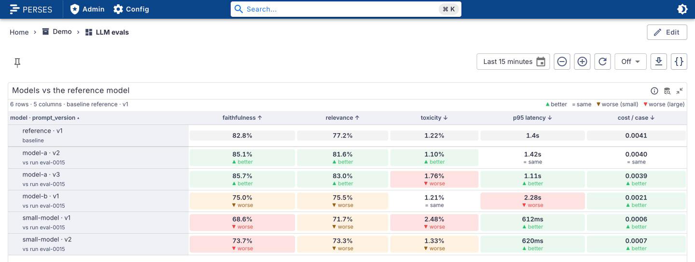
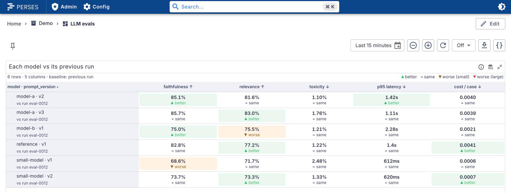
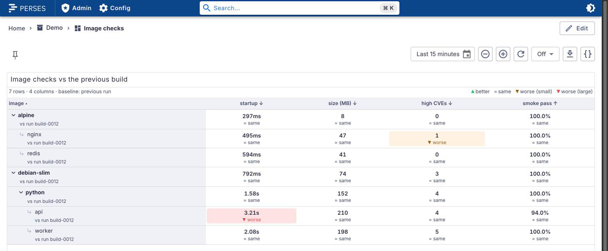
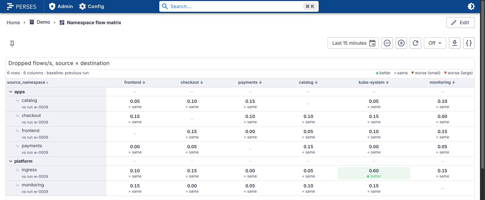
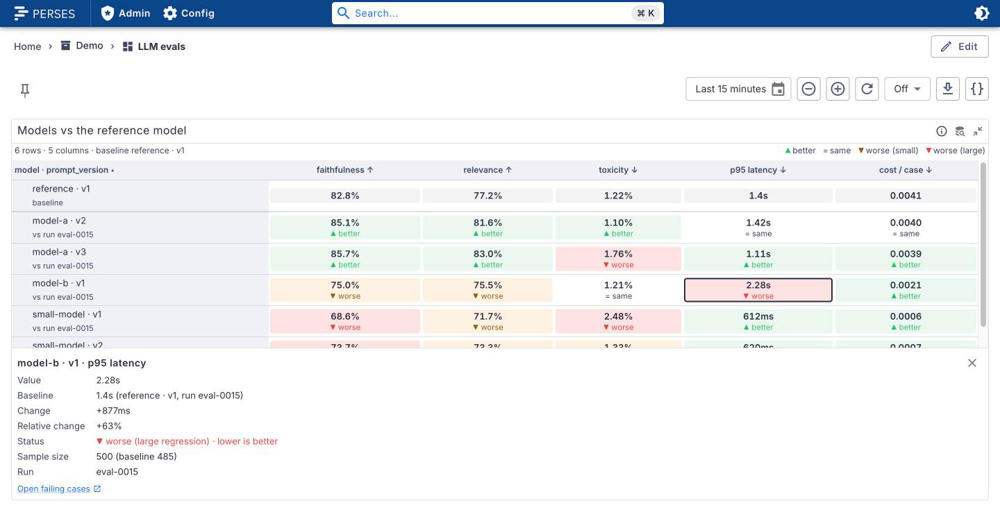

# perses-plugin-evalmatrix

A [Perses](https://perses.dev) panel plugin, `EvalMatrixChart`, for a rows × columns matrix where
every cell shows a value and how it moved against a baseline: a reference row or the previous run.
Each column knows whether higher or lower is better, so a drop in latency is green and a drop in
faithfulness is red. Built for LLM evals (model and prompt version × eval metric), and generic enough
for flow matrices (source × destination namespace) and acceptance checks per image.

<picture>
  <source media="(prefers-color-scheme: dark)" srcset="docs/images/hero-dark.png">
  
</picture>

It is the baseline/delta layer on top of a plain categorical matrix. The upstream proposal for a
generic matrix panel, [perses/perses#4573](https://github.com/perses/perses/issues/4573), colours
cells by value; this panel colours them by change against a baseline. If a matrix panel lands in
Perses, the baseline and delta logic here could be contributed to it (see
[docs/DECISIONS.md](docs/DECISIONS.md)).

```promql
llm_eval_score
llm_eval_cases_total   # optional second query: sample size per row and run
```

## Supported versions

| Plugin | Perses  | Status              |
| ------ | ------- | ------------------- |
| 0.1.x  | v0.55.x | Tested with v0.55.1 |

The plugin is built against `@perses-dev/*` 0.55.1 and `percli` v0.55.1. Other Perses minor versions
may work but are not tested.

## What it does

- **Rows and columns from labels.** `rowLabels` (one or more) make the row key, joined with `·`
  (`model-a · v2`); `columnLabel` makes the columns. Works with any time series query.
- **A baseline per cell.** Either a reference row (`baseline.mode: row`, pinned on top and marked
  "baseline") or each row's previous run (`previousRun`, captioned "vs run eval-0006").
- **Direction-aware deltas.** Every column has `better: higher | lower`. A change within the
  tolerance is **= same**; otherwise **▲ better** or **▼ worse**, and a regression is small (amber) or
  large (red) by size. Status is never colour alone: each cell carries a glyph, a word and an
  accessible name, and the header shows ↑ or ↓.
- **Tolerances** relative (2 % of the baseline) or absolute (in the column's unit), per panel or per
  column, with separate thresholds for "same" and for a large regression.
- **Detail strip.** Click a cell (or Tab to it and press Enter) for the value, the baseline with its
  row and run, absolute and relative change, the status and direction, the sample size against the
  baseline's, the run id, and a link (for example to the failing cases).
- **Row tree.** `rowTree` names a label whose value is a row's parent: another row (an image under
  its base image) or a group (namespaces under `apps`). Parents collapse.
- **Sorting** by any column, best values first, with the baseline row kept on top.
- Light and dark themes follow Perses; colours come from the theme.

200 rows with 12 columns render well within the test budget and stay responsive: the data transform
is memoised and rows only re-render when they change.

### Compared with the previous run

<picture>
  <source media="(prefers-color-scheme: dark)" srcset="docs/images/previous-run-dark.png">
  
</picture>

### Row tree

<picture>
  <source media="(prefers-color-scheme: dark)" srcset="docs/images/row-tree-dark.png">
  
</picture>

<picture>
  <source media="(prefers-color-scheme: dark)" srcset="docs/images/flow-matrix-dark.png">
  
</picture>

### Detail strip

<picture>
  <source media="(prefers-color-scheme: dark)" srcset="docs/images/detail-strip-dark.png">
  
</picture>

## Data

Any time series with labels works. The LLM eval contract the demo uses is in
[docs/metrics.md](docs/metrics.md):

| Metric                 | Labels                                        | Value                 |
| ---------------------- | --------------------------------------------- | --------------------- |
| `llm_eval_score`       | `model`, `prompt_version`, `metric`, `run_id` | the metric's score    |
| `llm_eval_cases_total` | `model`, `prompt_version`, `run_id`           | eval cases in the run |

Each series is reduced to its last sample in the time range. For each row the newest run (by
`runLabel`, default `run_id`) is shown; with `previousRun` the run before it is the baseline, so the
time range must cover at least two runs. `dev/eval-push.sh` is a reference pusher for a Pushgateway
(POSIX sh and curl), usable from any CI.

## Options

| Option            | Default                        | Meaning                                                   |
| ----------------- | ------------------------------ | --------------------------------------------------------- |
| `rowLabels`       | required                       | labels that make the row key, joined with `·`             |
| `columnLabel`     | required                       | label that makes the columns                              |
| `runLabel`        | `run_id`                       | label that tells runs apart                               |
| `baseline`        | none                           | `{ mode: row, row: "<key>" }` or `{ mode: previousRun }`  |
| `columns`         | from the data, alphabetical    | `name`, `displayName`, `better`, `format`, `tolerance`    |
| `tolerance`       | relative, same 0.01, large 0.1 | `{ mode: relative or absolute, same, large }`             |
| `rowTree`         | none                           | label naming a row's parent row or group                  |
| `sampleSizeQuery` | none                           | index of the query giving the sample size per row and run |
| `cellLink`        | none                           | URL in the detail strip                                   |
| `cellLinkLabel`   | `Open failing cases`           | text of that link                                         |

A column's `better` defaults to `higher`, its tolerance to the panel's. Listed columns come first in
the given order, the others follow alphabetically. With `baseline.mode: row` and no `row`, the first
row by name is the baseline. Without `large`, a relative tolerance uses 10 % and an absolute one ten
times `same`.

`cellLink` takes `${row}`, `${column}`, `${run_id}`, `${baseline_row}` and `${baseline_run_id}`,
URL-encoded, and dashboard variables. Only `http(s)` and relative links are shown. Every option has a
control in the panel editor.

```yaml
kind: EvalMatrixChart
spec:
  rowLabels: [model, prompt_version]
  columnLabel: metric
  baseline: { mode: row, row: reference · v1 }
  tolerance: { mode: relative, same: 0.02, large: 0.1 }
  columns:
    - {
        name: faithfulness,
        better: higher,
        format: { unit: percent-decimal, decimalPlaces: 1 },
      }
    - { name: answer_relevance, displayName: relevance, better: higher }
    - name: toxicity
      better: lower
      tolerance: { mode: relative, same: 0.05, large: 0.3 }
    - {
        name: latency_p95_seconds,
        displayName: p95 latency,
        better: lower,
        format: { unit: seconds },
      }
    - { name: cost_per_case_usd, displayName: cost / case, better: lower }
  sampleSizeQuery: 1
  cellLink: https://evals.example.com/runs/${run_id}?model=${row}&metric=${column}&filter=failed
```

The CUE schema is `schemas/panels/eval-matrix-chart/eval-matrix-chart.cue`, with an example next to
it and valid and invalid cases under `tests/`.

## Try it locally

`dev/` runs Perses with the plugin, Prometheus, a Pushgateway and three fake producers that push
every 30 seconds: LLM evals through `dev/eval-push.sh` (six model and prompt versions), Hubble-style
flow rates between namespaces, and acceptance checks per image. Three dashboards use them:
`llm-evals` (against a reference row and against the previous run), `flow-matrix` and
`image-checks`. The screenshots above come from it. It needs `podman compose` or `docker compose`.

```bash
npm ci && npm run build && percli plugin build
cp EvalMatrix-*.tar.gz dev/archive/
podman compose -f dev/docker-compose.yaml up -d    # PERSES_PORT, PUSHGATEWAY_PORT to move ports
```

Open <http://localhost:18086/projects/demo/dashboards/llm-evals>. The first runs show up within a
minute; previous-run deltas need two. `podman compose -f dev/docker-compose.yaml down` removes it.

## Build

```bash
npm ci
npm test               # Jest and React Testing Library
npm run build          # module-federation bundle in dist/
percli plugin build    # writes EvalMatrix-<version>.tar.gz
```

See `CONTRIBUTING.md` for the checks and the release process, and `docs/DECISIONS.md` for the design
choices.

## Install into Perses

Perses extracts every `*.tar.gz` in `plugin.archive_paths` into `plugin.path` at startup. Setting
`archive_paths` replaces the default, so keep the directory of bundled plugins in the list. Pick one
of the three options below and restart Perses.

### Option A: release archive

Download `EvalMatrix-<version>.tar.gz` from the
[GitHub releases](https://github.com/astrona-io/perses-plugin-evalmatrix/releases), check it against
its `.sha256`, put it in a directory Perses can read, and add that directory to the config:

```bash
curl -fLO https://github.com/astrona-io/perses-plugin-evalmatrix/releases/download/v0.1.0/EvalMatrix-0.1.0.tar.gz
```

```yaml
plugin:
  archive_paths:
    - /etc/perses/plugins-archive # plugins bundled with Perses
    - /etc/perses/plugins-archive-evalmatrix # put EvalMatrix-0.1.0.tar.gz here
```

### Option B: Kubernetes image volume

The `Containerfile` packages the archive as a plugin-only OCI image (`FROM scratch`, the archive at
the image root). Every release publishes it as `ghcr.io/astrona-io/perses-plugin-evalmatrix:v<version>`
for linux/amd64 and linux/arm64. Mount it into the Perses pod as an
[image volume](https://kubernetes.io/docs/concepts/storage/volumes/#image) and add the mount path to
`archive_paths` as in option A. Image volumes need a cluster and container runtime that support them
(the `ImageVolume` feature; check your Kubernetes version and feature gates).

```yaml
volumes:
  - name: evalmatrix-plugin
    image:
      reference: ghcr.io/astrona-io/perses-plugin-evalmatrix:v0.1.0
      pullPolicy: IfNotPresent
containers:
  - name: perses
    volumeMounts:
      - name: evalmatrix-plugin
        mountPath: /etc/perses/plugins-archive-evalmatrix
        readOnly: true
```

To build and push the image to your own registry instead:

```bash
percli plugin build
podman build -t <registry>/perses-plugin-evalmatrix:<version> .
podman push <registry>/perses-plugin-evalmatrix:<version>
```

### Option C: custom Perses image

Copy the archive into the directory of bundled plugins. No config change is needed, because that
directory is in the default `archive_paths`:

```dockerfile
FROM persesdev/perses:v0.55.1
COPY EvalMatrix-0.1.0.tar.gz /etc/perses/plugins-archive/
```

## Licences and credits

The plugin is Apache-2.0 (`LICENSE`). Third-party material and its notices are listed in `NOTICE`:
the Perses shared CUE schemas, vendored into the archive at build time (Apache-2.0). The grid, row
tree, detail strip and link handling started as a copy of
[perses-plugin-oat-results](https://github.com/astrona-io/perses-plugin-oat-results) (Apache-2.0).
